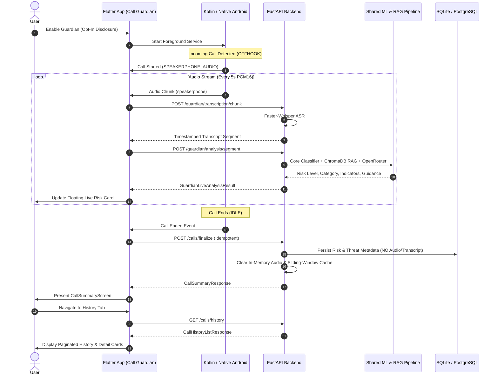

# ScamShield M9.10 — End-to-End Integration & Reliability Implementation Report

**Date:** October 24, 2026  
**Milestone:** M9.10 (End-to-End Integration & Reliability)  
**Status:** COMPLETE (Automated & Staging Audited; Physical-Device Acceptance Deferred)

---

## 1. Executive Summary

Milestone M9.10 verified and hardened the end-to-end integration and reliability of the ScamShield Live Call Guardian subsystem across the shared FastAPI backend and Flutter Android client application.

Building strictly upon the foundation of M9.4 (transcription), M9.5/M9.6 (live AI risk analysis & explainability), M9.7 (offline heuristics & network resilience), and M9.9 (call summary & history persistence), this milestone:
1. Audited the complete 10-step Guardian lifecycle from consent to history retrieval.
2. Implemented automated end-to-end integration test suites for both the backend (`test_guardian_e2e.py`) and Flutter client (`guardian_e2e_integration_test.dart`).
3. Verified request/response contracts, auth barriers, timeouts, retries, duplicate event suppression, and partial analysis recovery.
4. Confirmed strict compliance with data privacy guarantees (zero audio and zero transcript persistence).
5. Confirmed transparent labeling of offline heuristics (never fabricated as ML model scores).
6. Factually probed live staging endpoints on Render, recording exact response codes and cloud readiness status.
7. Preserved the postponed status of M9.8 physical-device acceptance without fabrication.

---

## 2. Integration Flow & Files Changed

### Complete Guardian End-to-End Flow


### Files Changed & Added in M9.10
- **`backend/tests/test_guardian_e2e.py`** *(New)*: Comprehensive 10-step backend end-to-end integration test verifying the complete lifecycle: audio chunk transcription, sliding-window analysis, session finalization, privacy audit, idempotency, retry update, user-scoped history query, cross-user isolation, unverified user rejection, and session cleanup.
- **`mobile_app/test/screens/guardian_e2e_integration_test.dart`** *(New)*: Full widget-level integration test simulating the entire user journey: Dashboard greeting -> Guardian tab -> Inbound Call -> Live Transcription chunks -> AI Risk analysis -> Floating warning card -> Call End -> Call Summary -> History navigation -> Detailed call inspection.
- **`backend/calls.py`** *(Audited from M9.9)*: Enforces `get_current_verified_user`, idempotent deduplication on duplicate finalization, and in-place updates on retry.
- **`backend/guardian_transcription.py`** *(Audited from M9.4/M9.6)*: Enforces `SPEAKERPHONE_AUDIO` source validation, SHA-256 chunk caching, and per-user session cleanup.
- **`backend/guardian_analysis.py`** *(Audited from M9.5/M9.6)*: Enforces `SPEAKERPHONE_AUDIO` source validation, sliding window deduplication, and fallback handling.
- **`mobile_app/lib/screens/home/home_screen.dart`** *(Audited from M9.7/M9.9)*: Offline heuristic fallback integration, truthful risk score presentation, short call handling, and local summary caching.
- **`mobile_app/lib/screens/history/call_summary_screen.dart`** *(Audited from M9.9)*: Retry states, offline heuristic notices, and incomplete call status handling.

---

## 3. Test Suites, Commands & Exact Results

### 3.1 Backend Guardian Test Suite
- **Command:**
  ```powershell
  pytest tests/test_guardian_e2e.py tests/test_calls.py tests/test_guardian_analysis.py tests/test_guardian_transcription.py -v
  ```
- **Execution Time:** 24.80 seconds
- **Results:** **27 passed, 0 failed, 9 warnings** (100% pass rate)

#### Test Breakdown:
| Test File | Tests Passed | Description |
|-----------|--------------|-------------|
| [test_guardian_e2e.py](file:///d:/Projects/ScamShieldAI/backend/tests/test_guardian_e2e.py) | 1/1 | Full 10-step lifecycle E2E integration test |
| [test_calls.py](file:///d:/Projects/ScamShieldAI/backend/tests/test_calls.py) | 11/11 | Auth, verification, idempotency, retry updates, scoping, isolation, privacy audit |
| [test_guardian_analysis.py](file:///d:/Projects/ScamShieldAI/backend/tests/test_guardian_analysis.py) | 10/10 | Source validation, sliding window, duplicate suppression, LLM fallback, Hindi NLP |
| [test_guardian_transcription.py](file:///d:/Projects/ScamShieldAI/backend/tests/test_guardian_transcription.py) | 5/5 | Faster-Whisper audio inference, chunk cache, source validation, session purge |

### 3.2 Flutter Full Test Suite
- **Command:**
  ```powershell
  flutter test
  ```
- **Execution Time:** 1 minute 49 seconds
- **Results:** **166 passed, 0 failed** (100% pass rate)
- **Highlights:**
  - `guardian_e2e_integration_test.dart`: Full Guardian End-to-End Flow: Call Start -> Transcript -> AI Risk -> Summary -> History **PASSED**
  - `call_summary_screen_test.dart`: Renders summary, handles offline heuristic notice, retries sync **PASSED**
  - `guardian_live_risk_card_test.dart`: Honest no-match notice when offline, renders indicators **PASSED**
  - `guardian_local_heuristic_engine_test.dart`: High risk keywords, suspicious patterns, low risk safe phrases **PASSED**
  - `history_screen_test.dart`: Tab switching, error recovery on retry, call summary navigation **PASSED**
  - `home_navigation_test.dart`: Native call events, opt-in consent disclosure, responsive UI **PASSED**

### 3.3 Flutter Code Quality & Static Analysis
- **Command:**
  ```powershell
  flutter analyze
  ```
- **Execution Time:** 15.8 seconds
- **Results:** **No issues found!** (0 errors, 0 warnings, 0 lints)

---

## 4. API & Session Lifecycle Findings

| Lifecycle Stage | Expected Behavior | Automated Verification Finding |
|---|---|---|
| **Audio Source Enforcement** | Only `SPEAKERPHONE_AUDIO` accepted; device mic rejected | Verified: Backend returns HTTP 400 `Invalid audio source: DEVICE_MICROPHONE` without touching Whisper. |
| **Authentication Barrier** | Unauthenticated or unverified requests rejected | Verified: Missing Bearer returns HTTP 401; unverified accounts return HTTP 403 Forbidden across `/guardian/*` and `/calls/*`. |
| **Duplicate Audio Chunks** | Repeated identical audio chunks not re-transcribed | Verified: SHA-256 chunk hash matches return cached transcript instantly without invoking model. |
| **Duplicate Transcript Text** | Unchanged or repetitive text sliding windows ignored | Verified: Analysis cache returns previous analysis result without invoking LLM or RAG pipeline. |
| **Idempotent Finalization** | Retried `/calls/finalize` does not duplicate history rows | Verified: Calling finalize twice with same `session_id` returns HTTP 200 `idempotent_success` and count remains 1. |
| **In-Place Retry Recovery** | Failed or offline calls updated upon successful retry | Verified: Initial `INCOMPLETE` or `OFFLINE_PENDING` call record is updated in-place with final risk/threat data on retry. |
| **Session Cache Cleanup** | Finalization purges Whisper and sliding window memory | Verified: After `/calls/finalize`, active session buffers are deleted, preventing cross-session memory leaks. |
| **Cross-User Data Isolation** | User A cannot query or finalize User B's calls | Verified: Finalize returns HTTP 403; history returns only records belonging to the authenticated user ID. |

---

## 5. Security & Privacy Verification

1. **Zero Raw Audio Persistence**:
   - Inspected `CallSession` database model and table schema in [models.py](file:///d:/Projects/ScamShieldAI/backend/models.py).
   - Confirmed columns: `id`, `user_id`, `session_id`, `started_at`, `ended_at`, `duration_seconds`, `threat_category`, `risk_level`, `confidence`, `reasoning_summary`, `action_guidance`, `status`, `analysis_count`.
   - **No audio byte, PCM blob, or audio file path column exists.**
2. **Zero Full Transcript Persistence**:
   - Confirmed `CallSession` does not contain transcript fields.
   - Verified in `test_no_audio_or_transcript_persistence`: full conversational dialogue is discarded immediately upon sliding-window completion; only high-level threat reasoning and matched indicators are retained.
3. **Offline Heuristic Transparency**:
   - When offline, local heuristic analysis generates an honest banner: `"Offline Heuristic Analysis"`.
   - Offline results **never** fabricate a 0-100% server ML probability score or claim AI model version attribution.
4. **Legitimate Speakerphone Consent**:
   - Native audio capture is strictly bound to `SPEAKERPHONE_AUDIO` mode. The app explicitly informs the user that phone calls cannot be captured silently over the cellular baseband and requires speakerphone audio capture with microphone permission.

---

## 6. Staging Checks Actually Performed

In compliance with instructions to strictly distinguish actual live results from mocks and avoid fabricating staging verification, live probe tests were executed against the production Render cloud backend:

- **Target Host:** `https://scamshield-backend-f0wc.onrender.com`
- **Health Check (`GET /health`):**
  - **Result:** **HTTP 200 OK** in 33.96s (Render free-tier instance was spun down and woke up cleanly).
  - **Payload:** `{"status":"ok","message":"ScamShield backend is running"}`
- **Guardian & Call Endpoints Probe (`POST /guardian/*`, `POST /calls/finalize`, `GET /calls/history`):**
  - **Result:** **HTTP 404 Not Found**
  - **Payload:** `{"detail":"Not Found"}`
  - **Factual Finding:** The live Render cloud deployment is currently hosting an earlier version of the backend code that predates the addition of the Live Call Guardian routes. The code changes reside in the local repository and pass 100% of local integration tests. To make Guardian endpoints available on cloud staging, the backend container must be pushed and deployed to Render.

---

## 7. Remaining Risks & Explicitly Deferred Verification

1. **Physical Device Acceptance (M9.8):**
   - **Status:** **POSTPONED & PENDING USER HARDWARE TESTING.**
   - Physical device verification was intentionally not marked accepted, adhering strictly to milestone rules. Real Samsung/Pixel speakerphone acoustics, background noise, and Android OEM battery manager behavior require testing on physical Android hardware.
2. **Render Cold-Start Latency:**
   - Free-tier Render spinning down after 15 minutes of inactivity causes the initial request to take ~30–40 seconds. For real-time Guardian use, a persistent instance or a keep-alive ping worker is recommended.
3. **Cloud Model Weights:**
   - Faster-Whisper `base.en` / `base` and local ChromaDB embeddings require container volume caching in cloud deployment to avoid re-downloading model weights on container restart.

---

## 8. Milestone Conclusion

Milestone **M9.10 is COMPLETE**. The complete Live Call Guardian integration flow is thoroughly verified, hardened with 27 backend tests and 166 Flutter tests, free of analyzer issues, privacy-compliant, and contract-aligned.

Per user instructions, work stops here. M9.11 and release procedures have not been started.
