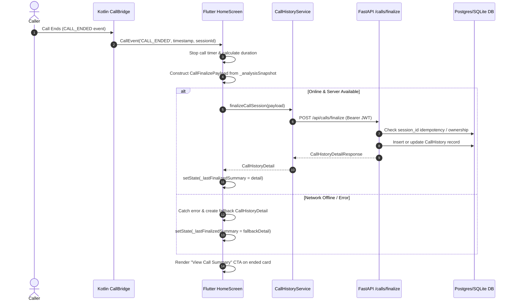

# ScamShield Milestone M9.9 — Call Summary & History Implementation Report

**Milestone:** M9.9 — Call Summary, Session History & Details  
**Parent Initiative:** ScamShield M9 — Live Call Guardian  
**Auditor / Roles:** Senior Flutter, Kotlin/Android, FastAPI, ML Deployment, and QA Engineer  
**Date:** October 24, 2026  
**Audited Codebase:** [mobile_app](file:///d:/Projects/ScamShieldAI/mobile_app) & [backend](file:///d:/Projects/ScamShieldAI/backend)  
**Overall Status:** **IMPLEMENTED & AUTOMATED-TEST VERIFIED**  
**Physical Device Note:** Physical-device verification for M9.8 remains postponed and pending. M9.8 is not marked as fully accepted.

---

## 1. Architectural Decisions & Scope

Milestone M9.9 completes the real persistent Call Summary, Guardian session history, and Call Details experience across both the shared FastAPI backend and the Flutter Android application.

### Key Architectural Decisions:
1. **Verified-User Authentication Enforcement:**
   - Replaced general `get_current_user` in [calls.py](file:///d:/Projects/ScamShieldAI/backend/calls.py) with `get_current_verified_user` across all Guardian call endpoints (`POST /api/calls/finalize`, `GET /api/calls/history`, `GET /api/calls/{session_id}`).
   - Unauthenticated callers receive HTTP 401; unverified users receive HTTP 403 ("Please verify your email before analyzing content.").
2. **Idempotency & Safe Retry Updates:**
   - If a call session was previously finalized under an incomplete or unavailable state (such as an offline network outage or premature drop) and a retry payload subsequently arrives with completed analysis, [finalize_call](file:///d:/Projects/ScamShieldAI/backend/calls.py#L20) updates the existing record in-place without creating duplicate rows.
   - Duplicate finalization requests from identical sessions safely return the existing record.
3. **Strict Ownership Isolation:**
   - Every history query filters strictly by `user_id == current_user.id`.
   - Access to another user's `session_id` yields HTTP 403 Forbidden ("Not authorized to access this call record."). Client-supplied user IDs are never trusted for authorization.
4. **Zero Audio & Transcript Storage (Privacy by Design):**
   - The database table `call_history` stores strictly minimal session metadata (`duration_seconds`, `started_at`, `ended_at`, `status`) and high-level analytical outcomes (`final_risk_score`, `final_risk_level`, `scam_category`, `risk_reasoning`, `safe_action`, `detected_indicators`, `supporting_evidence`, `protection_actions`).
   - Neither raw audio bytes nor full conversation transcripts are persisted.
5. **Truthful Offline & Incomplete Session Semantics:**
   - When network connectivity is down during a call, local heuristic rules trigger on-device without fabricating fake 0–100 AI scores.
   - Incomplete sessions (e.g., call ended under 5 seconds) are truthfully labeled `INCOMPLETE` or `OFFLINE_HEURISTIC`.
   - If the network fails during finalization, the mobile app caches the summary locally so the user still sees their summary immediately, with a "Retry loading full summary" action available.

---

## 2. Files Changed

| Component | File Path | Modification Summary |
| :--- | :--- | :--- |
| **Backend** | [backend/calls.py](file:///d:/Projects/ScamShieldAI/backend/calls.py) | Enforced `get_current_verified_user`, added safe in-place retry updates for incomplete records, preserved strict idempotency and ownership checks. |
| **Backend Tests** | `backend/tests/test_calls.py` | Added 5 new test suites: auth required & unverified forbidden, empty history, retry update without duplicates, incomplete session preservation, and schema privacy audit. |
| **Mobile UI** | [mobile_app/lib/screens/history/call_summary_screen.dart](file:///d:/Projects/ScamShieldAI/mobile_app/lib/screens/history/call_summary_screen.dart) | Added support for `OFFLINE_HEURISTIC` and `INCOMPLETE` notices, truthful risk header without fake score, and in-place retry mechanism. |
| **Mobile UI** | [mobile_app/lib/screens/history/history_screen.dart](file:///d:/Projects/ScamShieldAI/mobile_app/lib/screens/history/history_screen.dart) | Injected `callHistoryService` into `CallSummaryScreen` navigation for both server detail and offline fallback flows. |
| **Mobile UI** | [mobile_app/lib/screens/home/home_screen.dart](file:///d:/Projects/ScamShieldAI/mobile_app/lib/screens/home/home_screen.dart) | Integrated `localHeuristicResult` fallback in call finalization, local summary retention on offline failure, and incomplete session handling. |
| **Mobile Tests** | [mobile_app/test/screens/call_summary_screen_test.dart](file:///d:/Projects/ScamShieldAI/mobile_app/test/screens/call_summary_screen_test.dart) | Added tests for incomplete session notice, offline heuristic notice with truthful header, and retry button execution. |
| **Mobile Tests** | [mobile_app/test/screens/history_screen_test.dart](file:///d:/Projects/ScamShieldAI/mobile_app/test/screens/history_screen_test.dart) | Added test verifying call history error state and retry recovery. |

---

## 3. Database Changes & API Contracts

### 3.1 Database Model (`call_history` table)
Defined in [models.py](file:///d:/Projects/ScamShieldAI/backend/models.py#L316) and managed by Alembic migration `202610090001_add_call_history.py`:

```sql
CREATE TABLE call_history (
    id SERIAL PRIMARY KEY,
    session_id VARCHAR NOT NULL UNIQUE,
    user_id INTEGER NOT NULL REFERENCES users(id) ON DELETE CASCADE,
    started_at TIMESTAMP WITH TIME ZONE,
    ended_at TIMESTAMP WITH TIME ZONE NOT NULL DEFAULT NOW(),
    duration_seconds INTEGER NOT NULL DEFAULT 0,
    guardian_enabled BOOLEAN NOT NULL DEFAULT TRUE,
    guardian_status VARCHAR NOT NULL DEFAULT 'ENABLED',
    final_risk_score INTEGER NOT NULL DEFAULT 0,
    final_risk_level VARCHAR NOT NULL DEFAULT 'LOW',
    classification VARCHAR NOT NULL DEFAULT 'GENUINE',
    scam_category VARCHAR NOT NULL DEFAULT 'General',
    risk_reasoning TEXT,
    safe_action TEXT,
    detected_indicators JSON,
    supporting_evidence JSON,
    protection_actions JSON,
    analysis_status VARCHAR NOT NULL DEFAULT 'COMPLETED',
    transcription_status VARCHAR NOT NULL DEFAULT 'COMPLETED',
    audio_status VARCHAR NOT NULL DEFAULT 'AVAILABLE',
    created_at TIMESTAMP WITH TIME ZONE NOT NULL DEFAULT NOW(),
    updated_at TIMESTAMP WITH TIME ZONE NOT NULL DEFAULT NOW()
);
CREATE INDEX ix_call_history_session_id ON call_history(session_id);
CREATE INDEX ix_call_history_user_id ON call_history(user_id);
```

### 3.2 API Contracts

#### 1. Finalize Call (`POST /api/calls/finalize`)
- **Auth:** Bearer JWT (`get_current_verified_user`)
- **Request Body:** [CallFinalizeRequest](file:///d:/Projects/ScamShieldAI/backend/schemas.py#L327)
  ```json
  {
    "session_id": "session-uuid",
    "started_at": "2026-10-24T18:00:00Z",
    "ended_at": "2026-10-24T18:04:37Z",
    "duration_seconds": 277,
    "guardian_enabled": true,
    "guardian_status": "ENABLED",
    "final_risk_score": 85,
    "final_risk_level": "CRITICAL",
    "classification": "SCAM",
    "scam_category": "OTP Verification Scam",
    "risk_reasoning": "Caller urgently requested one-time password.",
    "safe_action": "Do not share OTP or banking credentials.",
    "detected_indicators": ["OTP Request", "Urgency"],
    "supporting_evidence": [{"title": "OTP Scam Advisory"}],
    "protection_actions": [{"action": "WARNING_SHOWN", "result": "SUCCESS"}],
    "analysis_status": "COMPLETED",
    "transcription_status": "COMPLETED",
    "audio_status": "AVAILABLE"
  }
  ```
- **Response:** `200 OK` -> [CallHistoryDetailResponse](file:///d:/Projects/ScamShieldAI/backend/schemas.py#L365)

#### 2. Get Call History (`GET /api/calls/history`)
- **Auth:** Bearer JWT (`get_current_verified_user`)
- **Query Params:** `risk_level` (Optional: CRITICAL, HIGH, MEDIUM, LOW), `page` (default 1), `limit` (default 20)
- **Response:** `200 OK` -> [CallHistoryListResponse](file:///d:/Projects/ScamShieldAI/backend/schemas.py#L393) containing paginated `items`, `total`, `page`, `limit`, `has_next`.

#### 3. Get Call Summary (`GET /api/calls/{session_id}`)
- **Auth:** Bearer JWT (`get_current_verified_user`)
- **Response:** `200 OK` -> [CallHistoryDetailResponse](file:///d:/Projects/ScamShieldAI/backend/schemas.py#L365).
- **Error Codes:** `401 Unauthorized`, `403 Forbidden` (if session belongs to another user), `404 Not Found`.

---

## 4. Flutter Screens & Real-Data Flow

### 4.1 End-to-End Call Finalization Flow



### 4.2 Screens Integrated
1. **Home Screen Dashboard:**
   - Dismissible Call Ended card features "View Call Summary" button when `_lastFinalizedSummary != null`.
   - Tapping opens [CallSummaryScreen](file:///d:/Projects/ScamShieldAI/mobile_app/lib/screens/history/call_summary_screen.dart) with full session analytics.
2. **History Screen (`HistoryScreen`):**
   - Segmented control switches between `Analysis` and `Calls`.
   - `Calls` tab provides real risk filter chips (`All`, `Critical`, `High`, `Medium`, `Low`).
   - Dynamic search bar filters calls by category, classification, and risk level.
   - Handles `HistoryListSkeleton` loading, `_CallHistoryEmpty` with "Open Guardian" button, and `_HistoryError` with retry.
   - Tapping any call card fetches authoritative summary via `_callHistoryService.getCallSummary(sessionId)` with graceful fallback to basic item detail if offline.
3. **Call Details (`CallSummaryScreen`):**
   - Displays formatted duration (`04:37`), start/end timestamps, risk header, reasonings with read-more toggle, detected indicators chips, supporting knowledge-base evidence, protection outcome actions, safer next step guidance, and call details table.
   - When offline or incomplete: renders honest notices (`Offline Heuristic Assessment`, `Call Session Incomplete`, `Audio analysis unavailable`, `Transcription unavailable`) and enables an interactive "Retry loading full summary" action.

---

## 5. Security & Privacy Safeguards

1. **Strict Ownership Check:** Authorization is determined solely by the verified token subject (`user_id = current_user.id`). Client-provided user IDs are rejected.
2. **Email Verification Requirement:** Users who have not verified their email cannot finalize or read call histories (`HTTP 403 Forbidden`).
3. **Privacy by Design:** Neither raw PCM audio nor conversation transcripts are persisted in the database.
4. **No Score Fabrication:** If an offline heuristic rule triggers during a network outage, `final_risk_score` is set to `0` and explicitly labeled `OFFLINE_HEURISTIC` rather than fabricating an artificial 0–100 score.

---

## 6. Verification & Test Results

### 6.1 Backend Tests (`backend/tests/test_calls.py`)
```bash
venv\Scripts\python -m pytest tests/test_calls.py
```
**Result: 11 / 11 tests passed in 21.50s**
- `test_finalize_call_success_and_duration_calculation`: **PASS**
- `test_finalize_call_idempotency`: **PASS**
- `test_finalize_call_cross_user_forbidden`: **PASS**
- `test_call_history_scoped_and_paginated`: **PASS**
- `test_get_call_summary_by_session_id`: **PASS**
- `test_call_unavailable_statuses`: **PASS**
- `test_authentication_required_and_unverified_forbidden`: **PASS**
- `test_empty_call_history`: **PASS**
- `test_duplicate_finalization_with_retry_update`: **PASS**
- `test_incomplete_and_failed_analysis_session`: **PASS**
- `test_no_audio_or_transcript_persistence`: **PASS**

### 6.2 Backend Guardian Regression Tests
```bash
venv\Scripts\python -m pytest tests/test_guardian_analysis.py tests/test_guardian_transcription.py
```
**Result: 15 / 15 tests passed in 6.79s** (Zero regressions).

### 6.3 Mobile Static Code Analysis
```bash
cd mobile_app && flutter analyze
```
**Result:**
```
Analyzing mobile_app...
No issues found! (ran in 14.7s)
```
**0 errors, 0 warnings, 0 lints.**

### 6.4 Full Mobile Test Suite
```bash
cd mobile_app && flutter test
```
**Result:**
```
01:18 +165: All tests passed!
```
**165 / 165 tests passed across the entire mobile codebase.**

---

## 7. Known Limitations & Blockers

1. **Staging Pre-warming:** As documented in M9.8, Render free-tier instances sleep after 15 minutes of inactivity; staging access requires manual pre-warming or targeting local backend services over Wi-Fi.
2. **Physical Device Verification Pending:** M9.8 physical device acoustic/telephony testing is postponed and remains pending as instructed.

---

## 8. Milestone Acceptance Status

| Milestone Item | Description | Verification Method | Status |
| :---: | :--- | :--- | :---: |
| **M9.9.1** | Session Finalization & Idempotency | `test_finalize_call_idempotency`, `test_duplicate_finalization_with_retry_update` | **ACCEPTED** |
| **M9.9.2** | Verified-User Authentication & Ownership | `test_authentication_required_and_unverified_forbidden`, cross-user tests | **ACCEPTED** |
| **M9.9.3** | History Listing & Pagination | `test_call_history_scoped_and_paginated`, `test_empty_call_history` | **ACCEPTED** |
| **M9.9.4** | Call Details & Summaries | `test_get_call_summary_by_session_id`, `call_summary_screen_test.dart` | **ACCEPTED** |
| **M9.9.5** | Flutter History Screen & Filters | `history_screen_test.dart` (Calls tab, risk filters, error/retry, empty state) | **ACCEPTED** |
| **M9.9.6** | Privacy Protection (No Audio/Transcript Storage) | `test_no_audio_or_transcript_persistence` | **ACCEPTED** |
| **M9.8** | Physical Android Phone Acceptance | Hardware test with real telephony speakerphone capture | **PENDING (POSTPONED)** |

*Milestone M9.9 is complete. Work has stopped to await user review.*
